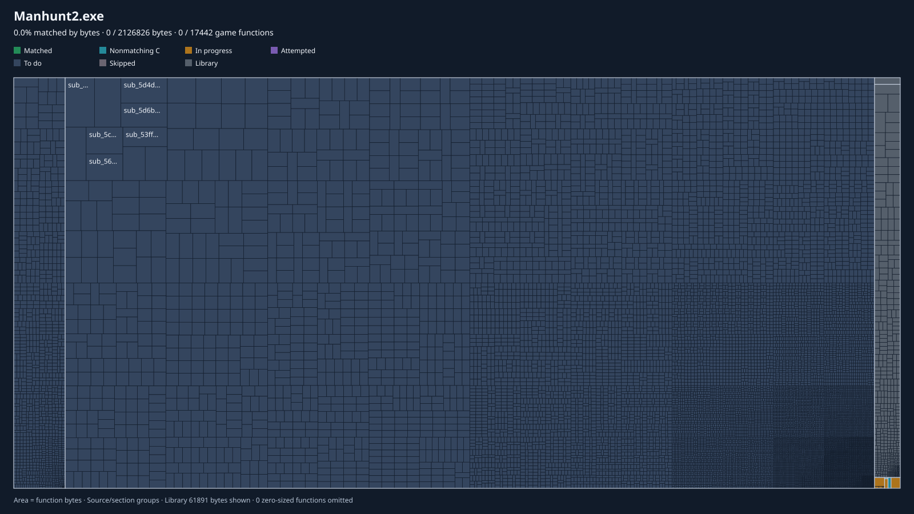

# Manhunt 2 — PC Decompilation

**English** · [Español](README_es.md)

A decompilation of the PC executable of **Manhunt 2** (2009) into readable source
code, to build a native **32-bit and 64-bit** port for Windows 10/11:

- no 2 GB memory limit
- no texture, model, pool or buffer limits
- HD model and texture support, mods loaded from folders
- **original game mods keep working** ([how](docs/MODS.md))
- no third-party patches needed to run on modern systems

## Decompilation Progress

**Status:** decompilation has started. Nothing compiles yet. Nothing is playable.

*One tile per function, area proportional to its code bytes, drawn by
[BinViz](https://github.com/trevor-e/binviz) from `decomp/functions.tsv`.*
**"Matched" will stay at 0 % by design:** in BinViz it means C that compiles to the
very same bytes, which this project does not attempt. Our verified functions show
as *Nonmatching C* (same behavior, proven by the oracle). See
[PROGRESS-TREEMAP.md](docs/PROGRESS-TREEMAP.md).

<!-- progress:start -->
| Metric (measured by `tools/tracking.py`) | Progress | % | Count |
|---|---|---|---|
| Game code decompiled to readable C/C++ (by bytes) | `░░░░░░░░░░░░░░░░░░░░` | **0.13 %** | 22 of 16,242 functions |
| Game code verified against the original (by bytes) | `░░░░░░░░░░░░░░░░░░░░` | **0.03 %** | 8 functions |
| Game functions with a confirmed name | `░░░░░░░░░░░░░░░░░░░░` | 0.19 % | 31 of 16,242 |
| DXUT functions replaced by the port | `░░░░░░░░░░░░░░░░░░░░` | 0.00 % | 0 of 20 identified |

Functions in the executable: 16,720. CRT, DXUT, import thunks and exception funclets are not part of the game-code total.
<!-- progress:end -->

These numbers are computed from [`decomp/functions.tsv`](decomp/functions.tsv) by
[`tools/tracking.py`](tools/tracking.py); nobody types them by hand. "Decompiled"
and "verified" are different things: see [METHODOLOGY.md](docs/METHODOLOGY.md).
Per-phase status, including the estimates we cannot measure, is in [PROGRESS.md](PROGRESS.md).

### Phases

<!-- phases:start -->
| # | Phase | Progress | % | M/E | Basis |
|---|---|---|---|---|---|
| 0 | Binary analysis and mapping | `█████░░░░░░░░░░░░░░░` | 25.0 % | E | headers, imports, DRM layout, entry, WinMain, DXUT and game init found; subsystems not mapped |
| 1 | Function inventory and library identification | `██████░░░░░░░░░░░░░░` | 30.0 % | E | inventory cross-checked with BinViz (+1,313 functions in two rounds); 296 CRT (FID) and 20 DXUT identified; other static libraries not separated |
| 2 | Subsystem map (strings, vtables, RTTI) | `█▌░░░░░░░░░░░░░░░░░░` | 8.00 % | E | boot, game object, audio, options, saves, CApp, text scripts, file path table (decoded) and .glg format located |
| 3 | Catalog of original limits (docs/LIMITS.md) | `█░░░░░░░░░░░░░░░░░░░` | 5.00 % | E | 3 limits, 1 bug and 5 fixed buffers found so far |
| 4 | Build skeleton x86 + x64 (CMake), boot with stubs | `░░░░░░░░░░░░░░░░░░░░` | 0.00 % | E | not started |
| 5 | Game data setup from installed folder or ISO | `░░░░░░░░░░░░░░░░░░░░` | 0.00 % | E | not started |
| 6 | Differential test harness (the oracle) | `██████████░░░░░░░░░░` | 50.0 % | E | loader, import traps, runner, live-input rule, thiscall calls and callee stubs work; 8 functions verified; generic side-effect diff missing |
| 7 | Decompilation: game code readable | `░░░░░░░░░░░░░░░░░░░░` | 0.13 % | M | measured by bytes of game code |
| 8 | Decompilation: game code verified | `░░░░░░░░░░░░░░░░░░░░` | 0.03 % | M | measured by bytes of game code |
| 9 | Original mod support (docs/MODS.md) | `▊░░░░░░░░░░░░░░░░░░░` | 4.00 % | E | plan written; 1 of 18 plugin features located; file hook point (path table) found; nothing implemented |
| 10 | Improvements: widescreen, FPS, XInput, modern renderer | `░░░░░░░░░░░░░░░░░░░░` | 0.00 % | E | not started |

**M** = measured from `decomp/functions.tsv`. **E** = estimate, kept deliberately conservative, for phases with no countable unit yet (edit `docs/phases.tsv`).
<!-- phases:end -->

## Documentation

| Read this | If you want to |
|---|---|
| [GETTING-STARTED.md](docs/GETTING-STARTED.md) | understand the project from zero, with vocabulary and setup |
| [METHODOLOGY.md](docs/METHODOLOGY.md) | know how functions are decompiled and checked |
| [CONTRIBUTING.md](docs/CONTRIBUTING.md) | help: rules, workflow, commit conventions |
| [GOALS.md](docs/GOALS.md) | see what the port must do, and what it will not |
| [MODS.md](docs/MODS.md) | know how original mods and ASI plugins are supported |
| [AI-DISCLOSURE.md](docs/AI-DISCLOSURE.md) | know how the code is produced |
| [PROGRESS.md](PROGRESS.md) | see the full project state and verified facts |

## How the port will be set up

You will need your own copy of Manhunt 2 for PC, either:

- an **installed game folder**, or
- the **game disc ISO**.

The port reads the game data from either one. It never uses the original
executable.

## Legal

This repository contains **only original code and documentation**. It does not
include the executable, DLLs or any game asset. The project does not include or
document DRM removal.

Manhunt 2 is the property of Rockstar Games / Take-Two Interactive. This project is
not affiliated with them.
