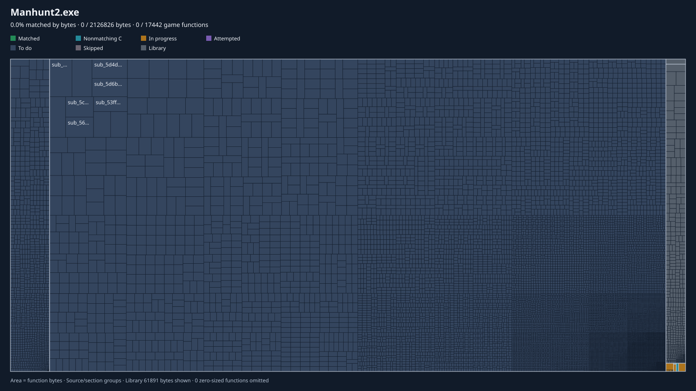

# Manhunt 2 — Decompilación de PC

[English](README.md) · **Español**

Decompilación del ejecutable de PC de **Manhunt 2** (2009) a código fuente legible,
para construir un port nativo de **32 y 64 bits** para Windows 10/11:

- sin el límite de 2 GB de memoria
- sin límites de texturas, modelos, pools ni buffers
- con soporte de modelos y texturas HD y mods cargados desde carpetas
- **los mods del juego original siguen funcionando** ([cómo](docs/MODS.md), en inglés)
- sin necesidad de parches de terceros para arrancar en sistemas modernos

## Progreso de la decompilación

**Estado:** la decompilación ha empezado. Nada compila todavía. Nada es jugable.

*Una casilla por función, con área proporcional a sus bytes de código, dibujada por
[BinViz](https://github.com/trevor-e/binviz) a partir de `decomp/functions.tsv`.*
**"Matched" se quedará en 0 % a propósito:** en BinViz significa C que compila a
exactamente los mismos bytes, y este proyecto no persigue eso. Nuestras funciones
verificadas salen como *Nonmatching C* (mismo comportamiento, demostrado por el
oráculo). Ver [PROGRESS-TREEMAP.md](docs/PROGRESS-TREEMAP.md) (en inglés).

<!-- progress:start -->
| Metric (measured by `tools/tracking.py`) | Progress | % | Count |
|---|---|---|---|
| Game code decompiled to readable C/C++ (by bytes) | `░░░░░░░░░░░░░░░░░░░░` | **0.08 %** | 9 of 14,929 functions |
| Game code verified against the original (by bytes) | `░░░░░░░░░░░░░░░░░░░░` | **0.01 %** | 2 functions |
| Game functions with a confirmed name | `░░░░░░░░░░░░░░░░░░░░` | 0.07 % | 10 of 14,929 |
| DXUT functions replaced by the port | `░░░░░░░░░░░░░░░░░░░░` | 0.00 % | 0 of 20 identified |

Functions in the executable: 15,407. CRT, DXUT, import thunks and exception funclets are not part of the game-code total.
<!-- progress:end -->

Estas cifras las calcula [`tools/tracking.py`](tools/tracking.py) a partir de
[`decomp/functions.tsv`](decomp/functions.tsv); nadie las escribe a mano.
"Decompilado" y "verificado" son cosas distintas: ver
[METHODOLOGY.md](docs/METHODOLOGY.md). El estado por fases, incluidas las
estimaciones que no se pueden medir, está en [PROGRESS.md](PROGRESS.md).

### Fases

<!-- phases:start -->
| # | Phase | Progress | % | M/E | Basis |
|---|---|---|---|---|---|
| 0 | Binary analysis and mapping | `█████░░░░░░░░░░░░░░░` | 25.0 % | E | headers, imports, DRM layout, entry, WinMain, DXUT and game init found; subsystems not mapped |
| 1 | Function inventory and library identification | `██████░░░░░░░░░░░░░░` | 30.0 % | E | inventory complete; 296 CRT (FID) and 20 DXUT functions identified; other static libraries not separated |
| 2 | Subsystem map (strings, vtables, RTTI) | `▌░░░░░░░░░░░░░░░░░░░` | 3.00 % | E | boot, audio, settings and clock entry points located |
| 3 | Catalog of original limits (docs/LIMITS.md) | `▌░░░░░░░░░░░░░░░░░░░` | 3.00 % | E | 2 limits found so far |
| 4 | Build skeleton x86 + x64 (CMake), boot with stubs | `░░░░░░░░░░░░░░░░░░░░` | 0.00 % | E | not started |
| 5 | Game data setup from installed folder or ISO | `░░░░░░░░░░░░░░░░░░░░` | 0.00 % | E | not started |
| 6 | Differential test harness (the oracle) | `████████░░░░░░░░░░░░` | 40.0 % | E | loader, import traps, runner and live-input rule work; 2 functions verified; callee stubs, thiscall helpers and side-effect diff missing |
| 7 | Decompilation: game code readable | `░░░░░░░░░░░░░░░░░░░░` | 0.08 % | M | measured by bytes of game code |
| 8 | Decompilation: game code verified | `░░░░░░░░░░░░░░░░░░░░` | 0.01 % | M | measured by bytes of game code |
| 9 | Original mod support (docs/MODS.md) | `▍░░░░░░░░░░░░░░░░░░░` | 2.00 % | E | plan written; 1 of 18 plugin features located; nothing implemented |
| 10 | Improvements: widescreen, FPS, XInput, modern renderer | `░░░░░░░░░░░░░░░░░░░░` | 0.00 % | E | not started |

**M** = measured from `decomp/functions.tsv`. **E** = estimate, kept deliberately conservative, for phases with no countable unit yet (edit `docs/phases.tsv`).
<!-- phases:end -->

## Documentación (en inglés)

| Lee esto | Si quieres |
|---|---|
| [GETTING-STARTED.md](docs/GETTING-STARTED.md) | entender el proyecto desde cero, con vocabulario y preparación del entorno |
| [METHODOLOGY.md](docs/METHODOLOGY.md) | saber cómo se decompila y se comprueba cada función |
| [CONTRIBUTING.md](docs/CONTRIBUTING.md) | ayudar: reglas, flujo de trabajo, convenciones de commits |
| [GOALS.md](docs/GOALS.md) | ver qué debe hacer el port y qué no hará |
| [MODS.md](docs/MODS.md) | saber cómo se soportan los mods originales y los plugins ASI |
| [AI-DISCLOSURE.md](docs/AI-DISCLOSURE.md) | saber cómo se produce el código |
| [PROGRESS.md](PROGRESS.md) | ver el estado completo y los hechos verificados |

## Cómo se instalará el port

Necesitas tu propia copia de Manhunt 2 para PC, ya sea:

- la **carpeta del juego ya instalada**, o
- la **ISO del disco** del juego.

El port lee los datos del juego de cualquiera de las dos. Nunca usa el ejecutable
original.

## Legal

Este repositorio contiene **solo código y documentación propios**. No incluye el
ejecutable, las DLL ni ningún asset del juego. El proyecto no incluye ni documenta
la eliminación de DRM.

Manhunt 2 es propiedad de Rockstar Games / Take-Two Interactive. Este proyecto no
está afiliado a ellas.
